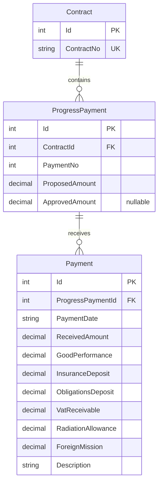
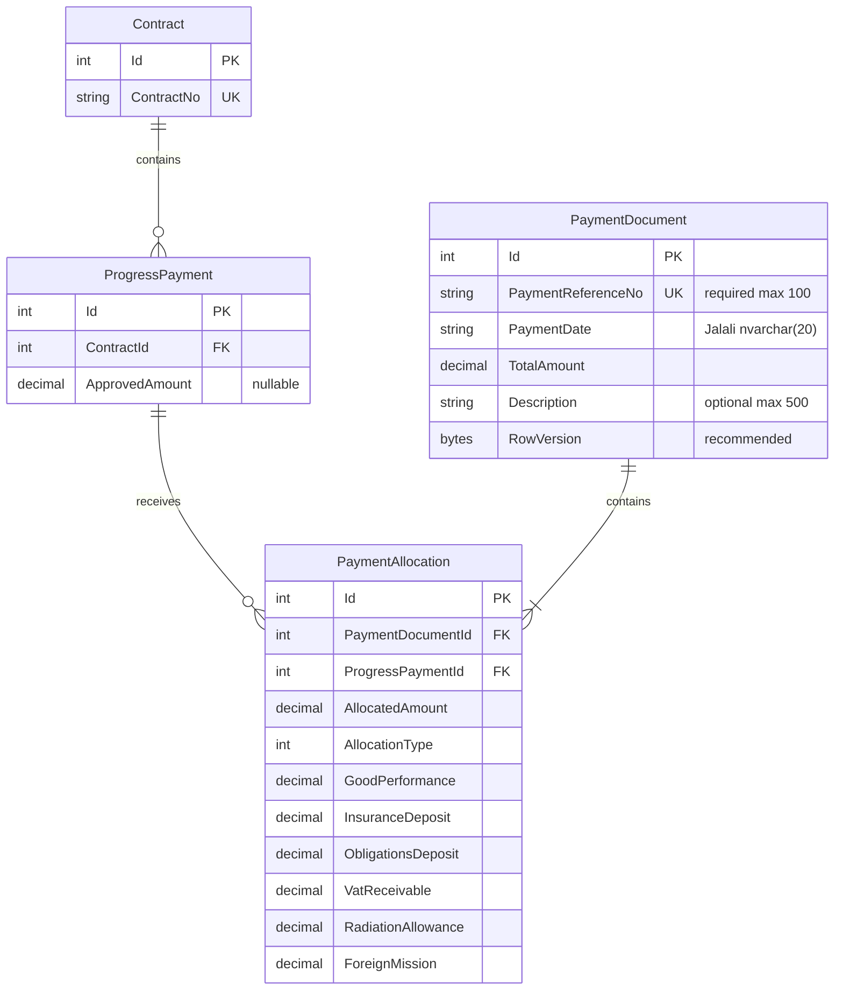

# Payment Module Redesign — Final Implementation-Ready Analysis

## 1. Executive summary

The proposed Master–Detail structure fits the existing application without introducing a new architectural layer or framework.

**Final scope:** All business decisions in this report are resolved. The target design uses `PaymentDocument` headers and `PaymentAllocation` details, mandatory globally unique references of at most 100 characters, Jalali string dates, optional descriptions, and decimal IRR amounts. Implementation remains a future, separately approved phase; this document does not authorize code or database changes.

**Recommended direction:** retain ASP.NET Core MVC, Razor views, the existing service-based structure, and EF Core configuration in `AppDbContext`. Replace `Payment` with `PaymentDocument` and `PaymentAllocation`, with all payment mutations handled as document-level transactions.

The main findings are:

- **Verified:** Each current `Payment` belongs to one `ProgressPayment`.
- **Verified:** `ProgressPayment` maps to the SQL table **`invoice`**, not `ProgressPayments`.
- **Verified:** Current payments allow zero amounts and do not prevent overpayment.
- **Verified:** Editing `ApprovedAmount` currently does not check existing payments.
- **Verified:** The six financial fields are stored independently and do not participate in the current balance calculation.
- **Verified:** The latest migration removes `PaymentReferenceNo`; the new header must introduce it again.
- **Recommendation:** Protect allocation creation, editing, deletion, and approved-amount changes using a consistent transaction/concurrency strategy.
- **Recommendation:** Discard old development payments through a targeted schema migration while preserving contracts, progress payments, principals, and attachments.

**Analysis boundary:** The initial analysis was read-only. This report has subsequently been saved and updated with product-owner decisions; only `PAYMENT_MODULE_ANALYSIS.md` is changed by this documentation task. No source code or migrations were generated or modified, and no database commands, builds, tests, installations, or commits were performed. An existing modification to `Views/Payments/Index.cshtml` was present before inspection and remains untouched.

Throughout this report:

- **Verified** means supported by inspected source or checked-in migration definitions.
- **Confirmed business decision** means a final product-owner requirement for the future implementation, not a claim that current code already enforces it.
- **Recommendation** means proposed implementation behavior.
- **Technical implementation consideration** means an engineering detail or environment verification still to complete during implementation; it does not reopen a confirmed business decision.

The actual database schema and applied migration history were not queried. Database findings below describe the checked-in model and migration history.

## 2. Current payment architecture

### Application structure

**Verified:** The repository contains one .NET 10 web project:

[backend/ContractInvoice.Api/ContractInvoice.Api.csproj](/E:/ContractProjectMain/backend/ContractInvoice.Api/ContractInvoice.Api.csproj)

It references EF Core SQL Server and EF Core Design version `10.0.12`.

The implemented request flow is:

**MVC controller → DTO validation and mapping → scoped service → AppDbContext → SQL Server**

Razor views provide the frontend. There is no separate repository layer, SPA, or payment-specific REST API in the inspected source.

`PaymentsController`, `PaymentService`, and `IPaymentService` implement synchronous CRUD. Create/edit controllers map DTO fields explicitly. POST actions validate antiforgery tokens and return validation failures to the form.

### Current entity behavior

**Verified:**

`Payment` contains:

- `Id`
- `ProgressPaymentId`
- `PaymentDate`
- `ReceivedAmount`
- The six financial fields
- `Description`
- `ProgressPayment` navigation

It has no document header, allocation mode, document total, or current reference-number property.

`ProgressPayment` contains a required `ContractId`, nullable `ApprovedAmount`, and `ICollection<Payment> Payments`.

`Contract` contains `ICollection<ProgressPayment> ProgressPayments`. There is no direct contract-to-payment relationship.

### Current calculations

| Value | Verified implementation |
|---|---|
| `ApprovedAmount` | Entered through progress-payment DTOs and stored directly; not calculated from other amounts. |
| `TotalPaid` | `PaymentService.GetTotalPaidByProgressPaymentId()` sums `Payment.ReceivedAmount`. |
| `RemainingAmount` | `ProgressPaymentsController.Details()` calculates `ApprovedAmount - totalPaid`, or `null` when approval is absent. |
| Six financial fields | Independently validated as nonnegative; excluded from `TotalPaid` and `RemainingAmount`. |
| Contract advance amount | Stored on `Contract`; no connection to the payment-balance formula was found. |

**Verified limitations:**

- Overpayment is possible.
- Payments against an unapproved progress payment are possible.
- Zero `ReceivedAmount` is accepted.
- Payment edits can move a payment to another progress payment.
- Progress-payment edits can reduce or clear approval despite existing payments.
- No explicit transaction enclosing validation reads and writes exists.
- No concurrency tokens or explicit locking strategy were found.
- Payment queries load tracked entities and materialize complete lists without pagination.

## 3. Relevant source files and responsibilities

All paths below are relative to `E:\ContractProjectMain`. Linked directory names provide access to their actual locations.

### Model and persistence

Directory: [backend/ContractInvoice.Api/Model](/E:/ContractProjectMain/backend/ContractInvoice.Api/Model)

| Actual file | Responsibility and impact |
|---|---|
| `Model/PaymentModel.cs` | Defines class `Payment`; replace with the two new entities. |
| `Model/ProgressPayment.cs` | Defines progress-payment fields and `Payments` navigation; change navigation to allocations. |
| `Model/ContractModel.cs` | Defines `Contract` and progress-payment navigation; no new payment FK required. |
| `Model/PrincipalModel.cs` | Principal-to-contract relationship; unaffected by payment replacement. |
| `Model/ContractAttachment.cs` | Contract attachments; preserve unchanged. |
| `Data/AppDbContext.cs` | DbSets, table/column mappings, precision, relationships, and indexes; replace payment configuration. |

Persistence configuration: [Data/AppDbContext.cs](/E:/ContractProjectMain/backend/ContractInvoice.Api/Data/AppDbContext.cs)

### Services, controllers, and DTOs

Directory: [backend/ContractInvoice.Api](/E:/ContractProjectMain/backend/ContractInvoice.Api)

| Actual file | Responsibility and impact |
|---|---|
| `Interfaces/IPaymentService.cs` | Payment CRUD/query interface. Its namespace is `ContractInvoice.Api.Services` despite its folder. Replace payment-specific contracts. |
| `Services/PaymentService.cs` | Payment CRUD, existence/nonnegative validation, eager loading, payment aggregation. Main replacement point. |
| `Services/ProgressPaymentService.cs` | Progress-payment CRUD and payment-dependent delete guard. Update allocation checks, approval-edit validation, and server-side restrictions on `ContractId`, `PaymentNo`, and `PaymentType`. |
| `Services/IProgressPaymentService.cs` | Progress-payment service contract; extend only where necessary. |
| `Services/ContractService.cs` | Contract CRUD; prevents deletion when progress payments exist. Retain this behavior. |
| `Controllers/PaymentsController.cs` | All payment MVC CRUD and dropdown population. Change to document-oriented operations. |
| `Controllers/ProgressPaymentsController.cs` | Retrieves payment history and builds financial summaries in `Details`. Change to allocation history. |
| `Controllers/ContractsController.cs` | Contract MVC operations; regression-check existing behavior. |
| `Controllers/ContractController.cs` | `/api/Contract` CRUD. No direct payment queries; retain contract deletion restrictions. |
| `Controllers/HomeController.cs` | Returns the navigation landing page; no financial calculations. |
| `DTOs/CreatePaymentDto.cs` | Current single-payment creation input; replace with header plus allocation collection. |
| `DTOs/UpdatePaymentDto.cs` | Current single-payment editing input; replace with document edit input. |
| `DTOs/CreateProgressPaymentDto.cs` | Includes nullable approved amount; retain fields and add service-level allocation-aware validation. |
| `DTOs/UpdateProgressPaymentDto.cs` | Inherits `CreateProgressPaymentDto`; affected by approval validation and allocation-dependent restrictions on `ContractId`, `PaymentNo`, and `PaymentType`. |
| `Program.cs` | Service registration, SQL Server provider, conventional MVC routing, Swagger, health endpoint. Update payment service registration if renamed. |

### Views and UI dependencies

Directory: [backend/ContractInvoice.Api/Views](/E:/ContractProjectMain/backend/ContractInvoice.Api/Views)

| Actual file | Responsibility and impact |
|---|---|
| `Views/Payments/Create.cshtml` | Single progress-payment selector and payment inputs; redesign as document entry. |
| `Views/Payments/Edit.cshtml` | Single-payment edit; redesign as aggregate editing. |
| `Views/Payments/Details.cshtml` | Displays one payment and its six fields; replace with header and allocation detail. |
| `Views/Payments/Index.cshtml` | Payment table and delete modals; change to one row per document. Contains a pre-existing local modification. |
| `Views/Payments/Delete.cshtml` | Standalone confirmation page; show document-wide impact. |
| `Views/ProgressPayments/Details.cshtml` | Casts `ViewBag.Payments` to `IEnumerable<Payment>`; displays balances and payment history. Directly affected. |
| `Views/ProgressPayments/Create.cshtml` | Progress-payment entry, including approved amount and Persian payment types. Preserve. |
| `Views/ProgressPayments/Edit.cshtml` | Approval and contract changes; show new validation errors. |
| `Views/ProgressPayments/Index.cshtml` | Lists progress payments and approved amounts; regression-check display and deletion. |
| `Views/ProgressPayments/Delete.cshtml` | Delete confirmation; preserve allocation-dependent restriction. |
| `Views/ProgressPayments/_Form.cshtml` | Existing partial with older English payment-type options; do not copy these options into the new UI. |
| `Views/Contracts/Details.cshtml` | Contract information, including advance amount; no payment-total calculation found. |
| `Views/Home/Index.cshtml` | Navigation cards, including Payments; no financial dashboard metrics. |
| `Views/Shared/_Layout.cshtml` | Persian RTL, sidebar, Bootstrap, Jalali date picker. Preserve conventions. |
| `Views/Shared/_ValidationScriptsPartial.cshtml` | jQuery validation dependencies; retain support for dynamic allocation rows. |
| `wwwroot/css/site.css` | Existing compact forms, tables, detail cards, and modal styling. Reuse. |

### Migration history

Directory: [backend/ContractInvoice.Api/Migrations](/E:/ContractProjectMain/backend/ContractInvoice.Api/Migrations)

| Actual file | Relevant responsibility |
|---|---|
| `20261025191908_InitialContractInvoiceSchema.cs` | Creates contracts, progress payments, and payments, including the original optional reference number. |
| `20261027185901_AddPrincipalsAndContractRelationship.cs` | Adds principal relationship; preserve. |
| `20261029083324_AddContractAttachments.cs` | Adds attachments; preserve. |
| `20261030061925_RenameProgressPaymentsToInvoice.cs` | Renames progress-payment table/columns and recreates payment FK against `invoice`. |
| `20261030121948_AddPaymentFinancialFields.cs` | Adds six financial columns and removes `PaymentReferenceNo`. |
| `AppDbContextModelSnapshot.cs` | Latest checked-in model; replace payment entity mapping in the future generated snapshot. |

Each of these five migrations also has a corresponding same-named `.Designer.cs` file containing its historical target model. Those historical `Payment` references should remain; they are not active application dependencies to remove.

### Documentation

**Verified:** `README.md` and the following documents reference payments:

- `docs/ARCHITECTURE.md`
- `docs/DATABASE.md`
- `docs/DOMAIN.md`
- `docs/AI_CONTEXT.md`
- `docs/ROADMAP.md`

Several descriptions are stale: older contract names, English progress-payment types, removed migration IDs, and the old reference-number field. Current source and migrations take precedence. Documentation should be corrected during implementation.

## 4. Current Entity Relationship Diagram

**Verified from the current model and migration snapshot:**

Physical tables are `Contracts`, `invoice`, and `Payments`.

Both financial relationships use restricted deletion:

- A contract cannot be deleted while progress payments reference it.
- A progress payment cannot be deleted while payments reference it.

## 5. Final proposed entity model and Entity Relationship Diagram

**Final business model with recommended technical concurrency metadata:** `RowVersion` is an implementation recommendation beyond the confirmed business fields.

**Cardinality:**

- One contract has zero or more progress payments.
- Each progress payment belongs to exactly one contract.
- Each allocation belongs to exactly one document and one progress payment.
- A progress payment can receive allocations from multiple documents.
- A document can contain allocations across multiple contracts.

**Confirmed business decision:** A document must contain at least one allocation whenever saved, including after editing. The diagram reflects this minimum; relational FKs alone do not enforce it, so server-side aggregate validation is required.

A unique database index on **`(PaymentDocumentId, ProgressPaymentId)`** prevents repetition within a document.

No `ContractId` is needed on either allocation or header. Contract selection is a UI filter; authoritative contract identity comes through `ProgressPayment.ContractId`.

## 6. Required database and entity changes

### New entities and mappings

**Confirmed requirements and technical mappings:** Reference presence, global uniqueness and maximum 100 characters, Jalali string dates, optional descriptions, and IRR `decimal(18,2)` money are final. Use the proposed `nvarchar(20)` date and `nvarchar(500)` description mappings, which align with the existing constraints. Concurrency metadata remains a technical recommendation.

| Property/group | Proposed storage |
|---|---|
| Entity IDs and FKs | `int`, identity primary keys |
| `PaymentReferenceNo` | Mandatory, globally unique, maximum 100 characters; `nvarchar(100)` |
| `PaymentDate` | Required Jalali date string, `nvarchar(20)`; preserve existing input/display conventions; no `DateOnly` or Gregorian `DateTime` storage |
| `Description` | Optional, nullable `nvarchar(500)`; null/empty descriptions never block saving. Technical normalization: treat whitespace-only input as empty and store it as null. |
| `TotalAmount`, `AllocatedAmount`, six financial fields | Confirmed: Iranian Rial (IRR), C# `decimal`, SQL `decimal(18,2)`; no implicit Toman conversion |
| `AllocationType` | Enum with explicit stable values for Full/Partial; persisted as integer |
| `RowVersion` | SQL Server `rowversion` on header, for stale document edit/delete detection |

Add:

- `DbSet<PaymentDocument>`
- `DbSet<PaymentAllocation>`
- Header-to-allocations navigation.
- Allocation-to-document and allocation-to-progress-payment navigations.
- `ProgressPayment.Allocations` replacing `ProgressPayment.Payments`.

Do not persist derived paid totals or balances.

### Constraints and indexes

**Confirmed requirements:** Enforce global `PaymentReferenceNo` uniqueness through both a database unique index and server-side validation. Enforce at least one allocation, allocation sum no greater than `TotalAmount`, and independent nonnegative, default-zero financial fields.

**Technical recommendations and required constraints:**

- Unique index on `PaymentDocuments.PaymentReferenceNo`, with required-value and uniqueness validation on create/edit. On edit, exclude the current document from the uniqueness lookup. Translate a concurrent unique-index violation into a recoverable validation error; a preliminary lookup alone is insufficient.
- Enforce the 100-character reference maximum and reject blank references server-side. Align reference comparison with the database index collation; do not use a case-sensitive application check against a case-insensitive unique index.
- Unique index on `(PaymentDocumentId, ProgressPaymentId)`.
- Separate index on `ProgressPaymentId` for balance/history queries.
- Required FKs to `PaymentDocuments` and `invoice`.
- Restricted deletion on both allocation relationships.
- Check constraint requiring `AllocatedAmount > 0`.
- Check constraint limiting `AllocationType` to its defined values.
- Check constraint requiring positive `TotalAmount`; positivity follows from at least one positive allocation and the document-total limit.
- Nonnegative checks and database defaults of zero for all six financial fields, with `decimal(18,2)` storage. Zero is valid.

The document-first unique index supports loading a document’s allocations. A separate document-ID-only index is unnecessary unless measured query behavior justifies it.

**Important:** Ordinary row-level check constraints cannot enforce the two aggregate limits across rows. Transactional service validation must enforce:

- Allocation totals against the progress payment’s approval.
- Document allocation totals against its header amount.
- At least one allocation on every document save, including edits.

### Existing objects to remove or retain

**Verified from migration history:**

| Object | Planned treatment |
|---|---|
| `Payments` | Drop with development payment data. |
| `PK_Payments` | Removed with table. |
| `IX_Payments_ProgressPaymentId` | Removed with table. |
| `FK_Payments_invoice_ProgressPaymentId` | Removed with table or explicitly before it. |
| Default constraints for six financial columns | Removed with table; generated SQL names need not be assumed. |
| `invoice`, `PK_invoice` | Retain. |
| `FK_invoice_Contracts_ContractId` | Retain. |
| `IX_invoice_ContractId_No` | Retain, including existing uniqueness. |
| `IX_Contracts_ContractNo` | Retain. |
| Principal and attachment objects | Retain. |

No checked-in stored procedures, triggers, database views, or raw SQL payment dependencies were found. Untracked database objects remain unverified until database metadata is inspected in the implementation phase.

### Migration strategy

**Confirmed direction:** Use a targeted forward migration. Only obsolete development payment records may be discarded; preserve every unrelated table and its data. Never reset the entire database or rewrite historical migration files. No migration is generated or executed in this documentation phase.

**Implementation sequence:**

1. Verify actual migration history and dependencies before generating the final migration.
2. Add one forward migration replacing the actual old `Payments` table with `PaymentDocuments` and `PaymentAllocations`, their constraints, indexes, and recommended header concurrency metadata.
3. Preserve historical migrations and their designer files.
4. Review SQL for changes outside the intended scope; confirm `Contracts`, `invoice`, `Principals`, `ContractAttachments`, and all unrelated data remain intact.
5. Verify both fresh schema creation and upgrade from the current development schema.
6. Apply only after implementation approval.

No old-payment conversion or database deletion is needed. A rollback may reconstruct the old schema but cannot recover discarded records.

## 7. Controller, service, DTO, query, and view changes

### Services

**Recommendation:** Introduce `PaymentDocumentService` and `IPaymentDocumentService` in the existing service/interface structure. No repository or generic unit-of-work layer is warranted.

Responsibilities:

- Load document lists and details.
- Find eligible progress payments by selected contracts.
- Enforce mandatory, globally unique references and at least one allocation on every save.
- Calculate allocation history and remaining balances.
- Validate and save complete documents.
- Perform controlled document deletion.
- Coordinate concurrency and translate expected persistence conflicts.

All allocation mutations should pass through this document service. Independent allocation-save endpoints would make header-total enforcement harder.

### DTOs and display models

Proposed DTOs—not existing files:

- `CreatePaymentDocumentDto`
- `UpdatePaymentDocumentDto`
- `PaymentAllocationDto`

Header input contains mandatory `PaymentReferenceNo` (maximum 100), Jalali string `PaymentDate` (maximum 20), decimal `TotalAmount`, optional `Description` (maximum 500), and the allocation collection. Each allocation input contains its target progress payment, mode, partial amount where applicable, and six independent decimal financial fields defaulting to zero. Mirror database lengths and monetary validation in DTO annotations and service checks.

Edit input additionally needs the header concurrency token and, if allocation identities are posted, validated allocation IDs.

**Technical recommendation:** Represent explicit Full reselection separately from the stored `AllocationType`, so posting an unchanged Full row does not trigger recalculation. Compare against persisted rows and validate the complete proposed document; do not trust client-provided original amounts or change flags as substitutes for validation.

Include review state for newly calculated Full amounts. Recommended mechanism: use existing ASP.NET Core data protection to bind a review token to the selected progress payment, calculated amount, mode, and edit document/version where applicable. Require confirmation of that preview and compare it with fresh server calculations at save time. A token records the reviewed preview; it never replaces balance validation or persists another monetary total. Use the same review process for explicit Full reselection during edits.

**Recommendation:** Use focused display ViewModels for document details and progress-payment financial history. This replaces fragile `ViewBag.Payments` casting without requiring application-wide ViewModel conversion.

Server-generated Full amounts must never be trusted merely because they arrive in a hidden/read-only input.

### Controllers and endpoints

**Verified existing routes:**

- `/Payments/Index`
- `/Payments/Details/{id}`
- `/Payments/Create?progressPaymentId=...`
- `/Payments/Edit/{id}`
- `/Payments/Delete/{id}`
- Corresponding Create/Edit/Delete POST actions

**Recommendation:** Retain `PaymentsController` and `/Payments` navigation, but make their IDs identify documents. This minimizes route and navigation churn.

Add a read-only action for outstanding progress-payment selection and, if needed, server-calculated preview totals. These are UI support endpoints, not a new public payment API.

**Verified:** The current progress-payment Details link exists but is explicitly disabled. **Confirmed change:** Enable the “New Payment” entry point and preserve `progressPaymentId` preselection. Open the document creation form with the originating progress payment and its contract selected; allow additional eligible progress payments from that contract or other contracts. Revalidate the originating ID and eligibility on the server. If it is no longer eligible, explain why and prevent its allocation while allowing selection of other eligible rows.

`/api/Contract`, `/api/Test`, and `/api/health` need no payment-specific replacement. Regression-check contract deletion and any entity serialization affected indirectly by navigation changes.

### Query changes

| Current dependency | Required replacement |
|---|---|
| `_context.Payments` CRUD | Document aggregate CRUD plus allocation persistence |
| Payment → ProgressPayment → Contract includes | Document detail → Allocations → ProgressPayment → Contract |
| `GetByProgressPaymentId()` | Allocation history including document date/reference |
| Sum of `ReceivedAmount` | Sum of `AllocatedAmount` |
| Progress-payment delete `Payments.Any()` | `PaymentAllocations.Any()` |
| `ProgressPayment.Payments` | `ProgressPayment.Allocations` |
| Payment detail/edit links in history | Document detail/edit links using `PaymentDocumentId` |

**Performance recommendation:** Project list rows and aggregate values in SQL, use no-tracking reads, and paginate document lists and contract/progress-payment searches. Avoid calling a balance query once per displayed row.

Do not join headers to allocations and then sum header totals: that would count a document once per allocation.

### Reports and dashboards

**Verified:** No implemented financial report/export module or financial dashboard aggregation was found. The home page contains navigation cards.

The existing financial summary requiring modification is `Views/ProgressPayments/Details.cshtml`.

Future contract summaries must sum allocations through progress payments. Unallocated document money cannot be attributed to a contract without an additional business rule.

## 8. Payment document creation and editing workflows

**Recommendation:** Retain Persian RTL, Jalali date inputs, compact sectioned forms, Bootstrap tables/modals, and existing card styling.

1. **Document information**  
   Enter a mandatory globally unique reference number of at most 100 characters, a Jalali string payment date, total amount in IRR with up to two decimal places, and an optional description of at most 500 characters. Null, empty, or whitespace-only description input must not prevent saving.

2. **Contract selection**  
   Select one or several contracts using a searchable selection control or checkbox list. This selection is not stored as another relationship. Entry from ProgressPayment Details preselects the originating progress payment and contract and permits adding other contracts.

3. **Outstanding progress payments**  
   **Confirmed eligibility:** Display only progress payments belonging to selected contracts with `ApprovedAmount > 0` and `RemainingAmount > 0`. No Contract status or ProgressPayment status filters apply. Show contract number/topic, progress-payment number/title/type, approved amount, previously allocated total, and remaining balance. Advances use the same eligibility and balance formula.

4. **Add allocation rows**  
   Add selected progress payments to the document. Disable already selected entries and enforce uniqueness server-side.

5. **Choose mode independently per row**  
   Full displays a server-calculated amount as read-only and requires review and confirmation before saving. Partial displays an editable positive amount. On edit, unchanged saved Full allocations retain their stored amounts; recalculation requires an explicit change to that allocation and selection of Full again, followed by review of the new amount.

6. **Enter allocation financial fields**  
   Provide a clearly associated expandable section or detail panel for all six fields:

   - `GoodPerformance`: حسن انجام کار
   - `InsuranceDeposit`: سپرده بیمه
   - `ObligationsDeposit`: سپرده حسن اجرای تعهدات
   - `VatReceivable`: طلب مالیات بر ارزش افزوده
   - `RadiationAllowance`: حق اشعه
   - `ForeignMission`: مأموریت خارج از کشور

   **Confirmed:** Each field defaults to zero, accepts zero and positive IRR amounts with two decimal places, prohibits negatives, and is stored independently per allocation. None affects allocation or remaining-balance calculations.

7. **Show document totals**  
   Continuously display document amount, allocation total, and unallocated remainder. Keep the six fields outside these totals.

8. **Review**  
   Show all allocations grouped visually by contract, with their mode, amounts, and financial fields. Require explicit confirmation of calculated Full amounts before save. Grouping must not introduce automatic allocation order or automatic distribution by priority/date.

9. **Save once**  
   Submit a document with at least one allocation. The server independently validates selected-contract membership, approval, eligibility, current balances, reference uniqueness, and the allocation total within the transaction. A positive unallocated remainder is allowed; an allocation total above the document total is prohibited.

10. **Handle changed balances**  
    Revalidate eligibility and amounts at save time. If a newly calculated or explicitly reselected Full amount differs from its confirmed preview, reject that save, explain the change, and show the refreshed amount for confirmation; never save an unreviewed replacement. Preserve entered information. Do not recalculate unchanged saved Full allocations: validate their stored amounts and explain any invalid balance instead.

Removing a contract filter must not silently delete entered allocations. Invalid forms must preserve row identities, selected contracts, amounts, and field-specific validation messages.

**Technical recommendation for edit screens:** Keep existing allocation rows visible even if they fully settled their progress payment. Apply positive outstanding-balance filtering to new selections; validate existing rows using the edit calculation that excludes the current document. This prevents a valid unchanged allocation from disappearing or being rejected merely because its own payment reduced the overall balance to zero.

**Editing workflow:** Load the document and its allocations; validate each saved amount against the current available balance excluding this document before presenting the editable state. Flag invalid saved rows clearly rather than silently repairing amounts. Preserve unchanged Full amounts while the user edits the header or other rows. Recalculate only an explicitly changed/reselected Full row, require review, and validate the entire proposed document again inside the save transaction. An invalid change rejects the whole save and retains user input. The initial edit-screen check is advisory and does not replace transactional revalidation.

## 9. Financial validation, calculations, and concurrency

### Confirmed business rules

- All amounts are Iranian Rial (IRR), with decimals allowed and `decimal(18,2)` monetary database columns. All financial calculations use decimal arithmetic; no implicit Toman conversion is allowed.
- `PaymentReferenceNo` is mandatory, globally unique across all documents, and limited to 100 characters; enforce application validation and a database unique index, including concurrent conflicts.
- `PaymentDate` is a Jalali date string stored as `nvarchar(20)` with existing Jalali input/display conventions. Do not change storage to `DateOnly` or Gregorian `DateTime`.
- `Description` is optional, with a maximum of 500 characters matching existing technical constraints. Null/empty descriptions are valid; normalize whitespace-only input to null without rejecting the document.
- Every saved document has at least one allocation. Allocation totals may be below, but never above, `TotalAmount`; a positive unallocated remainder is allowed.
- `GoodPerformance`, `InsuranceDeposit`, `ObligationsDeposit`, `VatReceivable`, `RadiationAllowance`, and `ForeignMission` belong to individual allocations. Each defaults to zero, permits zero and two decimal places, prohibits negatives, and is excluded from allocation and balance formulas.
- Eligibility requires positive approval and positive remaining payable balance for every progress-payment type, including advances. Selected contracts filter the selection UI; ownership is derived through `ProgressPayment.ContractId`. No Contract status or ProgressPayment status restrictions apply. Server-side eligibility and current-balance validation are mandatory regardless of UI filtering.
- Full creation requires displaying the calculated balance and user review/confirmation before saving. Revalidate on the server; a changed preview must be reviewed again rather than silently substituted.
- Unchanged Full allocations retain saved amounts on unrelated edits. Controlled transactional hard deletion and the progress-payment identity restrictions in section 10 are confirmed.
- Enable the ProgressPayment Details “New Payment” link with originating progress-payment preselection and support adding other eligible rows across contracts.
- The application is the only payment-data writer; no external applications or scripts modify payment data directly.

### Balance basis

**Confirmed business decision:** `ApprovedAmount` is the payable basis for every progress-payment type, including advances. No separate advance-payment formula applies. Do not substitute `ProposedAmount`, contract price, or contract advance amount.

For progress payment \(p\):

\[
TotalAllocated(p)=\sum AllocatedAmount \text{ for } p
\]

\[
RemainingAmount(p)=ApprovedAmount(p)-TotalAllocated(p)
\]

**Confirmed:** A progress payment with null or zero approval is ineligible. Registration also requires a positive remaining balance and membership in the selected contracts. **Technical recommendation:** Retain an undefined displayed balance for null approval; do not treat null as a payable amount. The existing display name `TotalPaid` can remain as an alias of progress-payment `TotalAllocated`, not as a separate stored total.

### Create and edit calculations

For a new document, previous allocations include every existing document.

For editing document \(D\):

\[
OtherAllocated(p,D)=
\sum AllocatedAmount \text{ where document is not } D
\]

\[
AvailableForDocument(p,D)=ApprovedAmount(p)-OtherAllocated(p,D)
\]

Validate the **complete proposed replacement set** for \(D\), excluding its old allocations from the calculation. This avoids counting old and replacement amounts together.

| Mode | Rule |
|---|---|
| New Full or explicit Full reselection | Server calculates the available balance for review/confirmation; reject when it is not positive. Save only if fresh transactional calculation matches the confirmed preview; otherwise return for renewed review. |
| Unchanged saved Full | Retain the saved amount; validate it against current available balance without automatically recalculating it. |
| Partial | Entered amount must be positive and no greater than the available balance. |
| Either | Validate the document-wide total after resolving all row amounts. |

Partial equal to the entire balance is allowed by the stated “must not exceed” rule.

For a document:

\[
DocumentTotalAllocated=\sum AllocatedAmount \text{ within the document}
\]

\[
UnallocatedAmount=TotalAmount-DocumentTotalAllocated
\]

**Confirmed:** Require at least one allocation and `UnallocatedAmount >= 0`. Exact allocation is not required; a positive unallocated balance is allowed.

**Example:** Approval is 1,000; other documents allocate 300. A Full allocation is 700. A Partial allocation may be any valid positive amount up to 700. The six financial fields do not change that calculation.

### Decimal handling

**Confirmed:** Store all amounts in IRR using `decimal(18,2)`, support decimal values, and perform financial calculations using decimal arithmetic. Never implicitly convert stored values or calculations to Toman.

**Implementation precision policy:** Validate monetary input before persistence. Accept amounts exactly representable to two decimal places; insignificant trailing zeros may be normalized (`1.230` is equivalent to `1.23`). Reject any amount requiring rounding (`1.231`) rather than silently rounding or truncating. Pad display to two decimals. Apply this consistently to document totals, allocation amounts, all six fields, and approved amounts used by this workflow. No database conversion or client formatting may silently round an invalid input into an accepted value.

**Technical validation requirements:**

- Retain `decimal(18,2)` consistently.
- Validate against its actual maximum, `9,999,999,999,999,999.99`; current DTO ranges allow larger CLR decimals than SQL storage supports.
- Enforce the precision policy above at DTO/service boundaries and before EF persistence; reject negative monetary values. Require positive allocation amounts and document totals; zero remains valid for the six independent fields.
- Normalize supported Persian/Arabic digits and separators before decimal parsing.
- Avoid JavaScript floating-point arithmetic for authoritative money calculations.
- Use server decimal previews or exact scaled-integer/string handling for client totals; ordinary JavaScript numbers cannot represent the full proposed SQL range exactly.
- Replace `N0` formatting in affected monetary displays with formatting that preserves the supported two decimal places and labels the unit as IRR/ریال.

### Transaction boundary

**Recommendation:** Begin the transaction before reading balances for validation; commit only after header and all allocation changes succeed.

A transaction around `SaveChanges` alone does not protect preceding balance checks. EF Core documents both automatic save transactions and explicit transaction scopes. [Microsoft: EF Core transactions](https://learn.microsoft.com/en-us/ef/core/saving/transactions)

### Concurrency strategy

**Recommendation:** Use database coordination on the affected progress-payment rows, plus optimistic concurrency for stale document forms.

A suitable SQL Server approach is:

1. Begin a short transaction.
2. For edits/deletes, lock the existing document and verify its submitted version.
3. Acquire transaction-held `UPDLOCK, HOLDLOCK` locks on affected `invoice` rows by primary key in ascending ID order, using parameterized SQL within the same connection/transaction as EF operations. Use sequential ordered acquisition rather than assuming an unordered set query locks rows in input order.
4. For edits, include the union of old and new progress-payment IDs.
5. After locks are acquired, read fresh approval values and allocation totals from the database; do not reuse pre-transaction balances or stale tracked values. Use a read-committed transaction with locking reads for these validations, not a transaction-level snapshot established before lock acquisition.
6. Validate identity protection, eligibility, decimal precision, reviewed Full previews, saved Full amounts, uniqueness, and document totals; persist the aggregate. Update the header even for detail-only edits so its rowversion advances.
7. Commit.

Transaction-held `UPDLOCK`/`HOLDLOCK` semantics can support this design. The exact implementation must be verified against SQL Server in integration tests. [Microsoft: SQL Server table hints](https://learn.microsoft.com/en-us/sql/t-sql/queries/hints-transact-sql-table?view=sql-server-ver17)

Every allocation mutation, approved-amount mutation, and allocation-dependent `ContractId`/`PaymentNo`/`PaymentType` change check must follow the same coordination protocol. Otherwise another writer can bypass the invariant or change identity while an allocation is being created.

A header `rowversion` detects stale edit/delete requests. Ensure the header is updated even for detail-only edits so its version advances. A rowversion on a progress payment **alone** does not protect concurrent inserts into its allocation collection. [Microsoft: EF Core concurrency](https://learn.microsoft.com/en-us/ef/core/saving/concurrency)

Handle deadlocks, lock timeouts, and stale-version conflicts with rollback and a recoverable user message. Never keep database locks open while the user reviews a form.

**Confirmed:** The application is the only payment-data writer; no external applications or scripts write payment data directly. Consequently all application write paths must use the shared protocol. A new document does not need an existing header lock, but must lock its target progress payments before balance reads. Progress-payment mutation/deletion locks its own row before checking allocations and does not acquire document locks afterward, avoiding reverse lock order. Document edit/delete locks its header first, then the sorted union of affected progress payments.

Treat reference conflicts separately from balance locking: the required unique reference index is the final arbiter for concurrent submissions, including documents involving disjoint progress payments. Roll back duplicate-reference or duplicate-allocation violations and return specific validation errors. Do not automatically retry a Full save with a newly calculated amount that the user has not reviewed. Translate SQL Server failures by constraint/error identity rather than presenting every database exception as a duplicate.

## 10. Editing and deletion behavior

### Editing a document

**Confirmed behavior with technical enforcement recommendations:**

- Permit adding, removing, and modifying allocations as one atomic operation.
- Validate saved amounts before editing and revalidate the full proposed state at save time. Use `AvailableForDocument`, not the overall remaining balance that already subtracts this document.
- Validate that posted allocation IDs belong to the document.
- Recalculate validation balances against allocations from all other documents; do not automatically recalculate unchanged Full amounts.
- Enforce at least one allocation and mandatory global reference uniqueness on edits as well as creation.
- Reject a reduced `TotalAmount` below the proposed allocation total.
- Reject stale document versions.
- Roll back the entire edit if any row fails.

**Confirmed Full-mode semantics:** A saved Full allocation retains its previously calculated `AllocatedAmount` when the description, other header information, or another allocation changes. Recalculation occurs only when the user explicitly changes that allocation and selects Full Payment again. All current balance and document-total validations still apply. A saved amount that now exceeds the permitted balance must cause validation failure; preserving it does not waive validation.

### Editing a progress payment

**Confirmed business decision:** When one or more allocations exist, changing `ContractId`, `PaymentNo`, or `PaymentType` is prohibited; `ApprovedAmount` cannot be cleared or reduced below total allocated amount. Deleting a ProgressPayment with allocations is prohibited, and deleting a Contract with ProgressPayments remains prohibited. Enforce these rules server-side, including crafted requests that bypass disabled UI inputs.

**Required validation and technical coordination:**

- Reject lowering approval below current allocated total.
- Reject clearing approval when allocations exist.
- Coordinate these checks with concurrent allocation saves.
- Check the three protected fields against persisted values before applying mutations or payment-type number normalization. Coordinate these checks with allocation creation so an allocation cannot appear between checking and saving.

**Verified related defect:** `ProgressPaymentsController` sets `Header_ContractNo` during edit mapping, but `ProgressPaymentService.Update()` does not copy it. Therefore this duplicated field can become stale. Use the actual `Contract` relationship for allocation identity and display; do not reproduce this redundancy in allocations.

### Deleting a document

**Confirmed business decision:** Controlled hard deletion is allowed in this development scope. The user must confirm after reviewing the document and its allocations. Delete the header and every allocation in one database transaction, leave other documents and allocations unchanged, and recalculate remaining balances from the allocations that remain.

**Technical recommendation:** Show reference, date, document total, allocated total, affected contracts, allocation count, and the allocation rows themselves. After confirmation:

- Revalidate document version.
- Coordinate affected progress payments.
- Explicitly remove allocations and header in one transaction.
- Keep restricted FKs rather than enabling blanket financial cascades.

Other documents remain unchanged. Their allocations are not automatically expanded or redistributed.

Removing the last allocation and saving the document is prohibited. The user must retain at least one allocation or use the confirmed whole-document deletion flow.

### Summary recalculation

Because paid totals and balances remain derived:

- Removing an allocation reduces `TotalPaid`.
- Remaining progress-payment balance increases accordingly.
- Document unallocated balance changes when its allocations change.
- No stored summary columns need repair.

Audit history, voiding, and reversals are outside this confirmed development hard-deletion scope. They should not be introduced implicitly or treated as blockers to the approved deletion policy.

## 11. Technical risks and implementation verification

| Classification | Finding or risk | Response |
|---|---|---|
| Verified | Source documentation describes older entities and migration history. | Update documentation from actual implementation. |
| Verified | No automated test project was found. | Add focused financial and SQL Server integration coverage. |
| Verified | Current money display commonly uses `N0`. | Preserve the confirmed two-decimal IRR amounts in affected displays. |
| Verified | Current payment DTOs omit some database string-length limits. | Align DTO, service, and database validation. |
| Verified | No authentication/authorization setup or payment authorization attributes were found. | Keep identity/role design outside this change unless requested; do not imply existing role protection. |
| Verified | Current progress-payment types include موقت، قطعی، تعدیل، پیش پرداخت; advance number is set to zero. | Preserve these rules and the existing composite unique index. |
| Verified | No current aggregate concurrency protection exists. | Include all relevant write paths in the new protocol. |
| Confirmed business decision | All financial amounts use Iranian Rial (IRR), with two decimal places. | Use decimal arithmetic and `decimal(18,2)`; prohibit implicit Toman conversion. |
| Confirmed business decision | The application is the only payment-data writer; there are no external writers. | Route all application mutations through the shared transaction/locking protocol. |
| Technical verification pending | Actual applied migrations and untracked database dependencies were not inspected. | Inspect before implementation migration application; this is not an unresolved product policy. |
| Recommendation | Existing list methods load all rows and related entities. | Use projections, grouped totals, and pagination. |

A separate migration concern exists if older development databases contain contracts when `AddPrincipalsAndContractRelationship` is applied: its required principal FK needs valid principal data. This is a pre-existing migration-path issue to verify, not a reason to reset the whole database.

## 12. Recommended implementation sequence

Each phase should produce a reviewable result.

| Phase | Work | Completion criterion |
|---|---|---|
| 1. Establish implementation baseline | Preserve the finalized business rules; inspect actual migration history, index collation, SQL Server isolation settings, and available test infrastructure. | Technical environment is understood; no business decisions are reopened. |
| 2. Define entity and input contracts | New entities, enum, DTOs, display models, navigation changes, IRR decimal precision, unique reference index, six-field defaults/checks, and explicit Full reselection input. | Model represents all agreed relationships without redundant contract data. |
| 3. Prepare targeted migration | Verify actual schema/history; generate and inspect replacement migration. | Only intended payment objects change; other modules remain intact. |
| 4. Implement transactional service | Create/edit/delete, approval-based balances for every type, eligibility checks, mandatory global references, at least one allocation, Full preservation/reselection, locking, version checks, error handling. | Financial invariants and unique references hold under concurrent operations; deletion is atomic. |
| 5. Protect progress-payment mutations | Approval reduction/clearing and delete checks; prohibit changing `ContractId`, `PaymentNo`, or `PaymentType` when allocations exist. | Server-side restrictions hold even for crafted requests and concurrent allocation creation. |
| 6. Implement document MVC workflow | Header form with reference/date/optional-description limits, selected-contract eligibility without status filters, Full review/confirmation and explicit reselection, independent six fields, IRR precision, and controlled deletion confirmation. | Complete workflow works with validation, preserved input, and unchanged Full amounts on unrelated edits. |
| 7. Update dependent screens | Document list/details/delete, progress-payment allocation history, and enabled New Payment link with preselection and multi-contract additions. | All payment links and summaries use document/allocation semantics and the entry point works end to end. |
| 8. Verify and document | SQL Server integration, functional UI tests, migration tests, documentation updates. | Acceptance scenarios pass and limitations are recorded. |
| 9. Apply approved development migration | Apply the reviewed schema change and smoke-test. | Development database and application model agree. |

Do not deploy a partially converted application against either schema. Database execution belongs after implementation approval and migration review.

## 13. Required functional and integration tests

### Relationships and registration

- One document, one allocation.
- One document, multiple progress payments from the same contract.
- One document, allocations across multiple contracts.
- Multiple documents allocating to the same progress payment.
- Duplicate progress payment rejected within one document, including a direct database uniqueness test.
- Missing document/progress-payment FK rejected.
- Six financial fields persist independently per allocation.
- Reference number exists only on the header.
- Missing or blank reference is rejected; duplicate references across documents/contracts are rejected by server validation and the database unique index.
- Editing without changing the reference succeeds; changing it to another document’s reference fails.
- A 100-character reference is accepted and a 101-character reference is rejected; application comparisons and the unique index agree under the configured SQL Server collation.
- Null, empty, and whitespace-only descriptions do not prevent create/edit; 500 characters are accepted and longer descriptions are rejected.
- Payment dates round-trip as Jalali strings in `nvarchar(20)` using the existing date input/display conventions, with no Gregorian or `DateOnly` storage conversion.
- Creating or saving an edited document with zero allocations fails.

### Financial rules

- Full uses current remaining balance after all prior allocations.
- Full never trusts a tampered submitted amount or forged/stale preview token; it requires a reviewed server-calculated amount and fresh transactional validation.
- A new Full allocation cannot save without review/confirmation. If another document changes the remaining balance after review, reject the save, show the refreshed amount, and require renewed confirmation.
- Partial accepts a valid positive amount, including exactly the remaining balance.
- Zero, negative, and excessive allocations are rejected.
- Allocation sum equal to document total succeeds.
- Allocation sum above document total fails.
- A positive unallocated remainder is accepted.
- No previous allocations produces a zero paid total.
- Null or zero approval is ineligible for selection and rejected on save.
- Advances use the same `ApprovedAmount - TotalAllocated` formula and eligibility rules as every other type.
- Registration excludes settled progress payments and those outside selected contracts; crafted requests and stale selections are independently validated server-side.
- Eligible rows remain selectable regardless of Contract or ProgressPayment status; no status-based filter is introduced.
- Every monetary value round-trips as IRR with two decimal places, with no implicit conversion to Toman.
- Each of the six fields defaults to zero, accepts zero and positive two-decimal amounts, and rejects negatives in server and database validation.
- Changing any of the six fields does not change allocation or balance totals.
- Exact two-decimal values and normalized trailing zeros succeed; amounts needing rounding (for example `1.231`), negative amounts, and values exceeding `decimal(18,2)` range fail before persistence. Verify this for every monetary field and the approval mutation path.
- Persian/Arabic digit and separator input round-trips correctly.

### Editing and deletion

- Editing excludes the current document’s old allocations.
- Other documents’ allocations remain included.
- Adding/removing/changing targets validates both old and new progress payments.
- Lowering document total below allocations fails.
- Posted allocation ID from another document is rejected.
- Description/header edits and edits to another allocation preserve an unchanged Full row's saved amount, even when other documents have changed its available balance.
- Explicitly changing a row and selecting Full again recalculates it using current balances.
- Explicit Full reselection requires confirmation of its recalculated amount; editing only a financial metadata field without reselection does not trigger recalculation.
- An unchanged Full row that now exceeds the available balance fails validation rather than being silently recalculated or accepted.
- Existing fully settling allocations remain visible and valid during unrelated edits, using the current-document exclusion calculation.
- Stale edit and stale delete are rejected.
- Deleting a document removes its allocations atomically and restores available balances.
- Deletion requires review of the document and allocation rows plus confirmation; other documents and allocations remain unchanged.
- Removing the last allocation through edit is rejected; deleting the whole document uses the controlled deletion flow.
- Progress-payment deletion is blocked while allocations exist.
- Contract deletion remains blocked while progress payments exist.
- Approval cannot be reduced below allocated total or cleared while allocations exist; a reduction exactly to allocated total is valid and leaves zero remaining balance.
- Each change to `ContractId`, `PaymentNo`, and `PaymentType` is rejected when allocations exist, including direct/crafted POSTs; unchanged protected values do not block valid edits.

### Transactions and concurrency

Use **real SQL Server**, separate connections/DbContexts, and deliberately overlapping transactions:

- Two users allocate the last available balance; both cannot overpay.
- Full and Partial allocations race against each other.
- Two documents with overlapping sets of progress payments save concurrently.
- Two users edit the same document.
- Header reduction races with an allocation edit.
- Approval reduction races with allocation creation.
- Protected progress-payment identity changes race with allocation creation without bypassing the restrictions.
- Concurrent creates/edits attempt the same reference; the unique index prevents duplicate documents and the losing transaction rolls back cleanly.
- Deletion races with edit or creation.
- Failure after header insertion rolls back header and details.
- Failure midway through an edit restores the original aggregate.
- Failure during deletion rolls back both header and allocation removal, preserving original balances.
- Deadlock/timeout leaves no partial writes and produces a recoverable response.

An in-memory provider cannot establish SQL Server locking, decimal storage, FK, or uniqueness behavior.

### UI, integration, and migration

- Antiforgery validation remains enforced.
- Invalid submissions preserve all rows and six-field values.
- Dynamic rows bind correctly after add/remove operations.
- Full mode has no editable allocation amount.
- Full creation and explicit Full reselection require review/confirmation; a changed preview cannot be silently substituted during save.
- The enabled New Payment link opens document creation with the originating progress payment/contract selected and permits adding eligible rows from other contracts. An ineligible or deleted originating ID produces a clear server-validated response without an invalid allocation.
- Contract selection prevents accidental loss of entered allocations.
- Review totals agree with saved decimal totals.
- Progress-payment history shows document reference/date and that progress payment’s allocation amount.
- Document list totals do not double-count headers.
- Existing sidebar, Jalali date picker, Persian RTL, details cards, and delete modals remain usable.
- Fresh migration chain and current-schema upgrade both succeed.
- The resulting schema enforces global reference uniqueness, allocation-pair uniqueness, financial defaults, nonnegative field checks, and `decimal(18,2)` storage.
- Contracts, `invoice`, principals, and attachments survive the payment replacement unchanged.

## 14. Remaining technical implementation considerations

**No unresolved business questions remain.** The following are engineering verification tasks for the implementation phase, not requests for additional business decisions:

1. **Database baseline:** Inspect the actual applied migration history and untracked database objects before generating the targeted forward migration. Verify that any pre-existing principal migration issue is handled without deleting unrelated data or rewriting historical migrations.
2. **SQL Server behavior:** Verify isolation settings and the ordered parameterized locking protocol against real SQL Server, including concurrent creation, edit, deletion, and progress-payment changes. Confirm that validation reads are fresh after lock acquisition and review deadlock/timeout handling.
3. **Reference equality:** Inspect the current collation and make application validation match the unique index. Use a single trimming/normalization routine without inventing bank/year scoping or alternate uniqueness rules; test whitespace and case behavior consistently. Mandatory global uniqueness and maximum 100 characters are fixed.
4. **Review and concurrency plumbing:** Implement and test protected Full-preview confirmation, explicit reselection input, and header rowversion advancement on detail-only edits. These mechanisms must preserve the confirmed review and no-silent-recalculation rules; they do not require a new persisted total or balance.
5. **Localization and precision:** Verify existing Jalali parsing/input behavior and Persian/Arabic digit normalization, invariant decimal binding, and formatting. Keep date storage as Jalali `nvarchar(20)` and enforce the no-rounding two-decimal policy throughout affected financial paths.
6. **Test infrastructure and performance:** Select a real SQL Server integration-test setup compatible with the repository, then verify query plans, grouped sums, paging, and transaction duration at representative allocation counts. No packages or tests are created in this documentation phase.

**Recommended sequence:** verify the technical baseline → implement the final model and reviewed migration → transactional service and concurrency protection → progress-payment protection → document UI, Full review, and entry point → SQL Server integration and UI tests → apply the approved development migration.

Implementation still requires explicit approval. The report's technical approach is implementation guidance; the confirmed business decisions require no reconfirmation.

## 15. Final documentation verification

- Resolved the previous questions about reference length, description content, external writers, status filters, Full review, and the payment-entry shortcut; none remains a business-policy blocker.
- Full creation/reselection uses reviewed server calculations and fresh validation; unrelated edits never recalculate saved Full allocations.
- The six financial fields remain independent and excluded from allocation and payable-balance calculations everywhere in the report.
- The final date mapping is consistently a Jalali string in `nvarchar(20)`; historical source findings remain explicitly labeled as such.
- The final reference is mandatory, globally unique, and maximum 100 characters; Description is optional with the existing 500-character limit.
- Document totals and balances are calculated rather than persisted, and the migration plan preserves unrelated data and historical migrations.
- This task changes only `PAYMENT_MODULE_ANALYSIS.md`. No application code, configuration, tests, migrations, database schema, or application data is changed. The pre-existing `Views/Payments/Index.cshtml` modification is not part of this task.

## Change summary

- Finalized the header/detail model, 100-character globally unique references, Jalali string dates, optional descriptions, IRR decimal precision, and calculated totals.
- Resolved all previous business questions: no status filters, no external writers, required Full review/confirmation, and enabled preselected payment creation with cross-contract additions.
- Aligned creation, edit, deletion, protection, transactional concurrency, targeted migration, acceptance tests, and phased implementation; defined a consistent two-decimal no-rounding policy.
- Preserved verified source findings, file paths, and both diagrams; replaced business questions with explicit technical implementation verification tasks.
- Documentation only: updated `PAYMENT_MODULE_ANALYSIS.md`; no functionality, source code, database, migrations, controllers, services, views, or other project files were modified.

**Documentation update is complete. Implementation remains paused pending explicit approval.**
